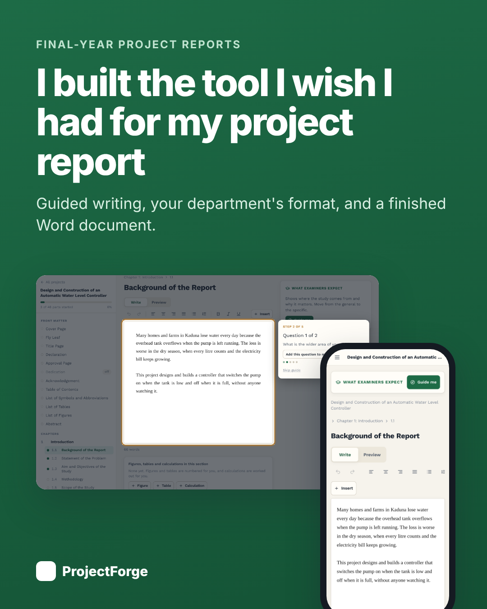
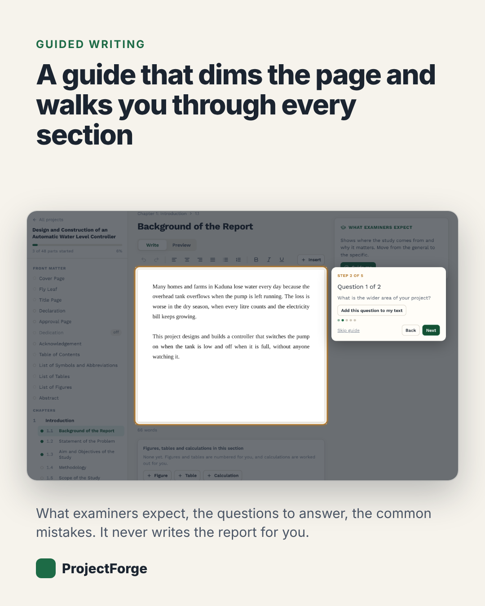
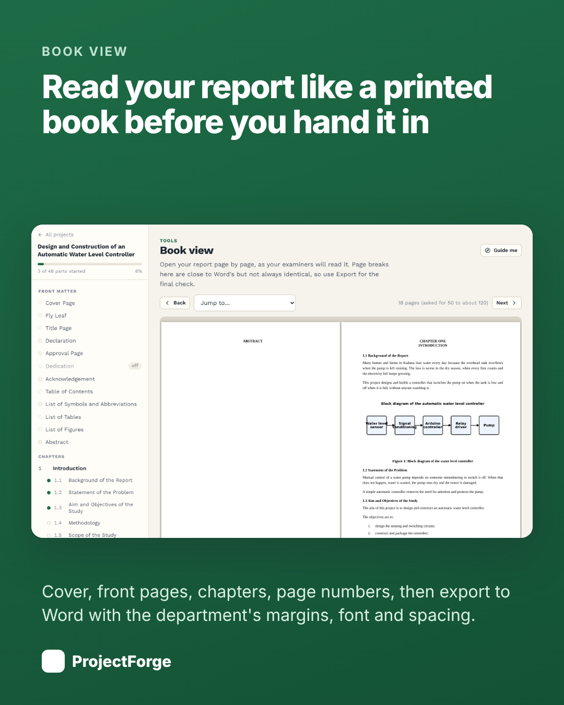
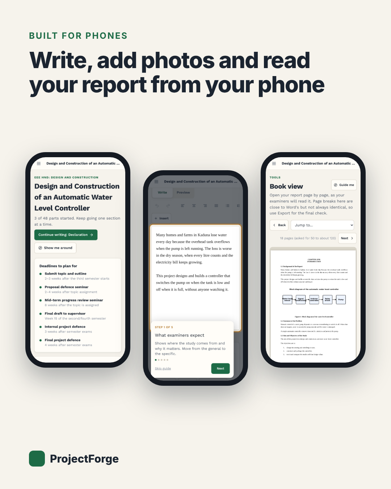

<div align="center">

# ProjectForge

**Write your final-year project report with a guide at every step.**

ProjectForge sets up a student's report the way the department wants it, tells them what to write in each section, and builds the finished Word document. It is made to work on a phone.

[How it works](#how-it-works) · [Features](#features) · [Run it locally](#run-it-locally) · [Deploy](#deploy) · [Admin and insights](#admin-and-insights) · [Project layout](#project-layout) · [Roadmap](#roadmap)



</div>

---

## Why this exists

Writing a project report is hard for a reason that has nothing to do with engineering: nobody shows you what goes where. Students get a PDF of guidelines and a blank page, then lose days to margins, page numbers, figure numbers and the table of contents.

ProjectForge turns the department's guidelines into a guided workspace. It currently follows the **Kaduna Polytechnic Electrical and Electronic Engineering HND** guidelines, for both project types:

- Design and construction
- Maintenance and repair

Chapter titles are left to the student, as the department allows.

## How it works

1. **Pick a project type.** The front pages, chapters and sections the department asks for are created for you.
2. **Write one section at a time.** A spotlight guide dims the page and walks you through what examiners expect, the questions to answer and the usual mistakes. It never writes the report for you.
3. **Add the evidence.** References, figures, tables and calculations are managed in their own tools and dropped into the text with a tap.
4. **Check, read, export.** Checks compare the report with the department's rules, Book view shows it page by page, and Export downloads a formatted Word file.

<p>
  
  
  
</p>

A narrated 3 minute walkthrough is at [`frontend/public/help/projectforge-walkthrough.mp4`](frontend/public/help/projectforge-walkthrough.mp4) and on the site's `/help` page.

## Features

**For students**

| | |
| --- | --- |
| **Guided sections** | Step-by-step spotlight guides for every section, front page and tool, shown once and available again on demand. |
| **Department format built in** | A4, Times New Roman 12 pt, 1.5 spacing, 25 mm left and 20 mm other margins, justified text, roman numerals for the front matter, arabic from chapter one, first page of each chapter numbered at the bottom centre. |
| **References** | IEEE or APA, switchable at any time. Citations and the reference list reformat by themselves. |
| **Figures and tables** | Auto-numbered in the order they appear. Phone photos are shrunk before upload. Storage in the database or on Cloudinary. |
| **Calculations** | A safe expression parser works out each step and writes the working the way examiners expect. Values like `4.7k` and `100m` work. |
| **Checks** | Compares the report with the department's guidelines: empty sections, missing details, unmatched citations, unreferenced figures and more. |
| **Writing coach** *(optional)* | Reads a section and points out what to improve, using Claude. It coaches and never ghostwrites. Off unless an API key is set. |
| **Editor** | Undo and redo, bold, italic, underline, paragraph and list alignment, bulleted and numbered lists, citation, figure, table and calculation insertion. |
| **Book view** | The report laid out page by page like a printed book, with a contents page that shows page numbers. |
| **Word export** | A finished `.docx` with cover, title page, declaration, approval page, contents, lists, chapters, references and appendices. |
| **Built for phones** | 44 px touch targets, slim guide card above the writing area, swipe to turn pages in Book view. |
| **Accounts** | Sign up, sign in, password reset by email, readiness questions that tune how much help is shown. |

**For the owner**

- A private admin area with an overview, a live activity feed, user management and a project list.
- An insights view of where students get stuck, built from counts only. See [Admin and insights](#admin-and-insights).
- A public [`/privacy`](frontend/app/privacy/page.tsx) page and a [`/help`](frontend/app/help/page.tsx) page with the walkthrough video.

## Tech stack

| Layer | Choices |
| --- | --- |
| Frontend | Next.js 15 (app router), React 19, Tailwind CSS 3, lucide-react |
| Backend | Node.js 20+, Express 5, TypeScript, Zod 4, Helmet, express-rate-limit |
| Database | PostgreSQL 16 with Prisma 6 |
| Documents | `docx` for Word export |
| Optional services | Anthropic (writing coach), Cloudinary (figure images), Resend (password-reset email) |
| Testing | Node's built-in test runner on the backend (91 tests), Playwright for browser checks |

Sessions use an HTTP-only cookie. The website forwards `/api` to the server, so the cookie is first-party, which matters on phones.

## Run it locally

You need Node.js 20 or newer and PostgreSQL 16.

```bash
git clone https://github.com/BOLA02/Ai-research.git
cd Ai-research
```

**1. Backend**

```bash
cd backend
npm install
cp .env.example .env          # then edit DATABASE_URL and the other values
npx prisma generate
npx prisma migrate deploy     # creates the tables
npm run dev                   # http://localhost:4000
```

**2. Frontend** (a second terminal)

```bash
cd frontend
npm install
npm run dev                   # http://localhost:3000
```

Open `http://localhost:3000` and sign up. The frontend forwards `/api` to `http://localhost:4000` by default.

> If `migrate deploy` stops with an "already exists" error, the local database was changed by hand at some point. For a throwaway local database, `npx prisma migrate reset` rebuilds it from the migrations. Do not use `prisma db push`.

### Useful commands

| Where | Command | What it does |
| --- | --- | --- |
| `backend` | `npm test` | Runs the 91 backend tests |
| `backend` | `npm run build` | Generates the Prisma client and compiles to `dist/` |
| `backend` | `npm run start:prod` | Applies migrations, then starts the compiled server |
| `backend` | `npm run seed` | Creates the development user from `SEED_USER_*` |
| `frontend` | `npm run build` | Production build |
| `frontend` | `npx tsc --noEmit` | Type check |

## Configuration

### Backend (`backend/.env`)

| Variable | Required | Purpose |
| --- | --- | --- |
| `DATABASE_URL` | yes | PostgreSQL connection string |
| `FRONTEND_URL` | in production | The website's address, for links in emails |
| `NODE_ENV` | | `production` on a live server |
| `TRUST_PROXY` | behind a proxy | Number of proxies in front of the server, so rate limits see the real visitor |
| `ADMIN_EMAILS` | for the admin area | Comma-separated emails that can open the admin area |
| `RESEND_API_KEY`, `MAIL_FROM` | for reset emails | Without a key, the reset link is printed in the server log (development only) |
| `CLOUDINARY_CLOUD_NAME`, `CLOUDINARY_API_KEY`, `CLOUDINARY_API_SECRET` | optional | Store figure images on Cloudinary instead of the database |
| `ANTHROPIC_API_KEY` | optional | Switches the writing coach on |
| `AI_MODEL`, `AI_DAILY_LIMIT`, `AI_BURST_PER_MINUTE` | optional | Coach model and per-student limits |

### Frontend (`frontend/.env.local`, or the host's settings)

| Variable | Purpose |
| --- | --- |
| `API_ORIGIN` | The server's address. The website forwards `/api` to it. Read at build time |
| `ADMIN_SLUG` | The secret address of the admin area, for example `desk-7f3k9q2m`. Read at build time |
| `NEXT_PUBLIC_CONTACT_EMAIL` | Shown on the privacy page for data requests |

## Deploy

The recommended setup keeps three small pieces:

```
Browser ──► Vercel (website) ──/api──► API server ──► PostgreSQL
```

- **Website:** Vercel, with the `frontend` folder as the root directory.
- **API server:** Render or Railway, with the `backend` folder as the root directory. Build with `npm ci --include=dev && npm run build`, start with `npm run start:prod`, health check `/api/health`.
- **Database:** any PostgreSQL, such as Neon, Railway's database or Render's.

Migrations run on every start. **Step-by-step instructions, environment tables and a post-deploy checklist are in [`DEPLOY.md`](DEPLOY.md).**

Two things to remember:

- Sign up with your own account **before** adding your email to `ADMIN_EMAILS`. Emails are not verified at sign-up.
- On a free host the server may sleep when idle, so the first visit after a quiet period can take up to a minute.

## Admin and insights

The admin area is for the owner only:

- It lives at a private address you choose with `ADMIN_SLUG`. With it set, `/admin` does not exist, nothing links to the area, and anyone else who finds the address sees a plain "not found" page.
- You also have to sign in with an email listed in `ADMIN_EMAILS`.

It has five views:

| View | What it shows |
| --- | --- |
| **Overview** | Students online, active, new sign-ups, projects, sections written, downloads, writing-coach use, failed sign-ins, and 14-day charts |
| **Where students struggle** | The sign-up funnel, which sections students start, which checks fail most, where guides are left, which tools are used, and errors |
| **Activity** | A live feed of key events, filterable by type or student |
| **Users** | Search, last activity, deactivate and reactivate |
| **Projects** | Each project with its owner, sections started and word count |

**Privacy by design.** The admin screens show numbers and events only. Student writing is never shown, and the analytics events can only carry a few short, fixed labels, never free text. The privacy note at `/privacy` describes exactly what is kept.

## Project layout

```
.
├── backend/
│   ├── prisma/                 schema and migrations
│   └── src/
│       ├── modules/            auth, projects, sections, sources, figures, tables,
│       │                       calculations, report (checks), export (Word),
│       │                       ai (coach), admin, activity (analytics)
│       ├── templates/          the department templates, format rules and guidance
│       ├── citations/          IEEE and APA formatters and marker parsing
│       ├── calc/               the safe expression parser for calculations
│       ├── lib/                prisma, cloudinary, mailer
│       └── config/env.ts       validated environment
├── frontend/
│   ├── app/                    routes: landing, auth, dashboard, projects, help, privacy, admin
│   ├── components/             workspace (editor, tours, tools), admin, tooltips
│   └── lib/                    api client, workspace state, book layout, analytics
├── DEPLOY.md                   deployment guide
└── linkedin/                   launch post and images
```

Templates are code, not database rows: adding a department means adding a template file with its sections, guidance, format rules and checks.

## Under the hood

- **Markers in the text.** Students write plain text with a few markers: `[@key]` for a citation, `[fig:label]`, `[tab:label]`, `[calc:label]`, `**bold**`, `*italic*`, `++underline++`, and `{right}` style alignment marks. The server resolves them for the preview and the export, so numbering is always consistent.
- **One report model.** The Word export, the Book view and the checks all read the same report model, so what the student sees matches what they download.
- **Safe calculations.** Formulas are parsed by a small recursive-descent parser. Nothing is ever passed to `eval`.
- **Coaching, not ghostwriting.** The writing coach returns structured feedback, and quotes it cites are verified against the student's own text before they are shown.
- **Book view.** Pages are poured into A4-sized CSS columns in the browser using the department's margins and font, and the contents page numbers come from measuring where each heading lands. Page breaks are close to Word's but not always identical, so Export is the final check.

## Known limitations

- Only the Kaduna Polytechnic EEE HND templates exist. Other departments need their own template.
- The Word export has been checked in LibreOffice and not yet in Microsoft Word. In Word, update the table of contents field if page numbers look wrong.
- Emails are not verified at sign-up.
- Sign-in limits count per address, so many students on one network can affect each other.
- Activity records are not deleted automatically.
- There is no offline mode. An unsaved edit is kept on screen and retried, but a long outage can lose recent typing.

## Roadmap

- Open the Word export in Microsoft Word and fix any differences
- Automatic clean-up of old activity records
- Email verification and a smarter sign-in limit
- Supervisor view: a read-only share link and comments
- Word and page count against the department's 50 to about 120 pages
- Phone-sized walkthrough video
- Templates for more departments
- Frontend tests and CI

## Contributing

Issues and pull requests are welcome. Please run the backend tests (`npm test` in `backend`) and the type check (`npx tsc --noEmit` in both folders) before sending a change, and keep student writing out of any logs or analytics.

## Privacy

ProjectForge stores student writing, so privacy is part of the design. Read [`/privacy`](frontend/app/privacy/page.tsx) for what is kept and who can see it. The privacy page is a plain-language draft; have it reviewed against your school's and your country's data-protection rules before relying on it.
